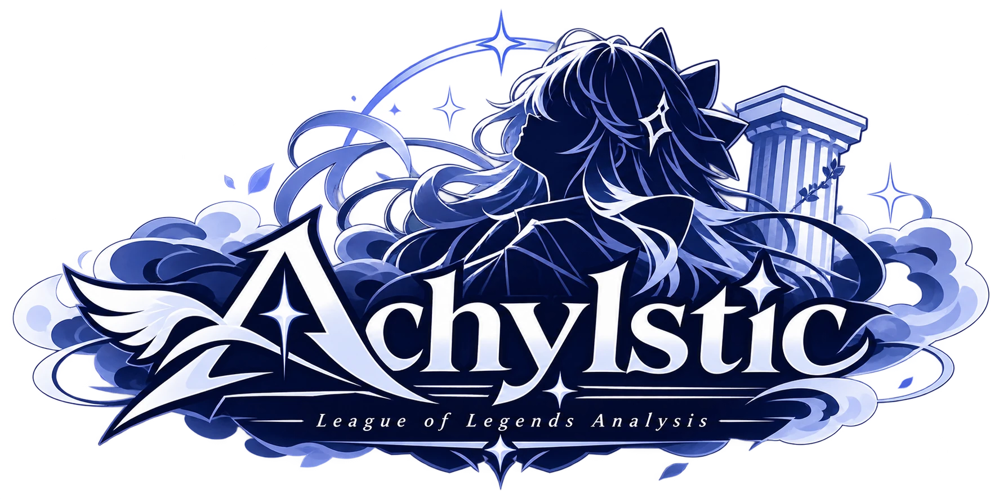
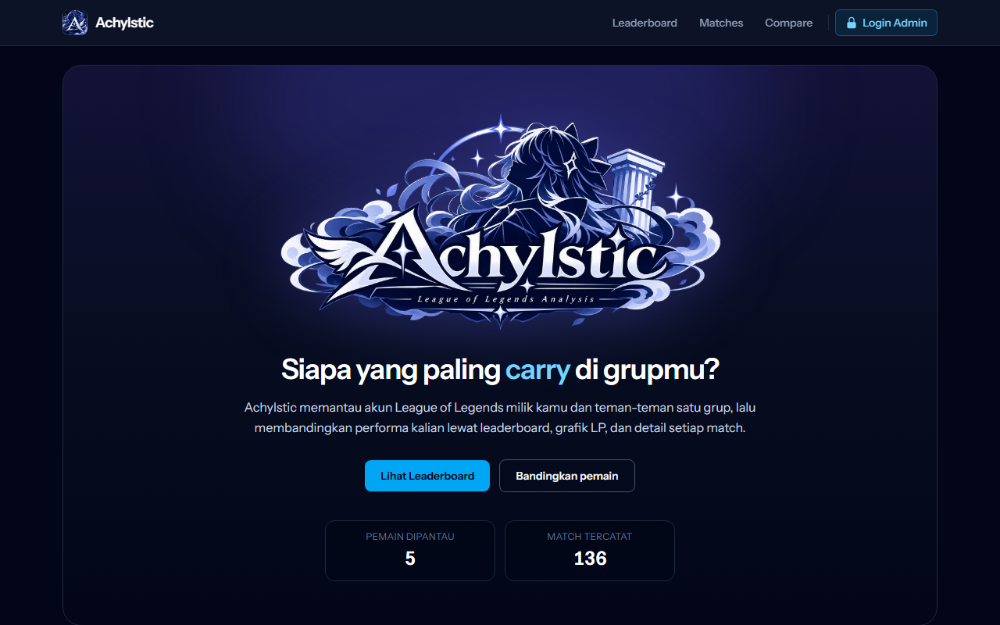
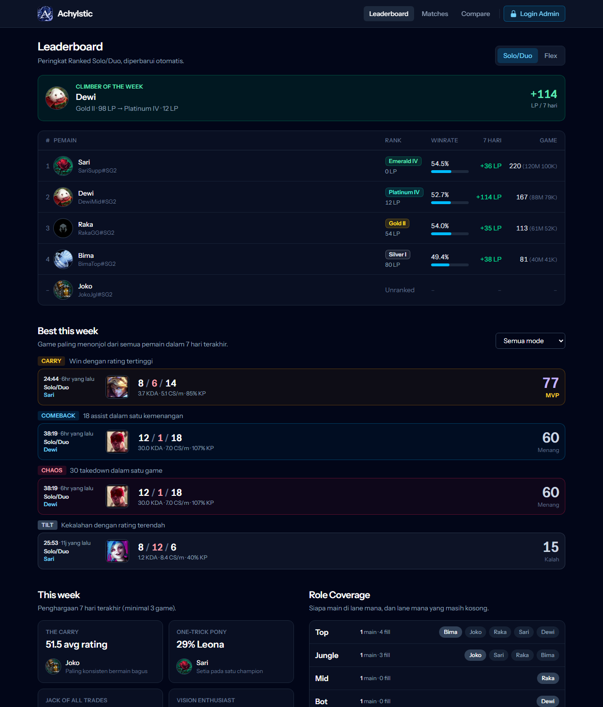
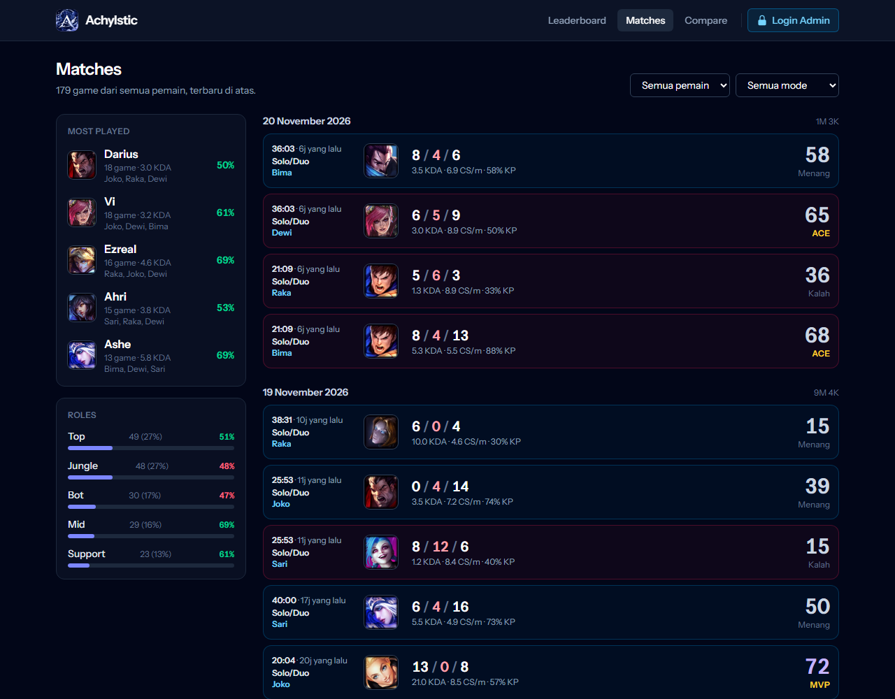
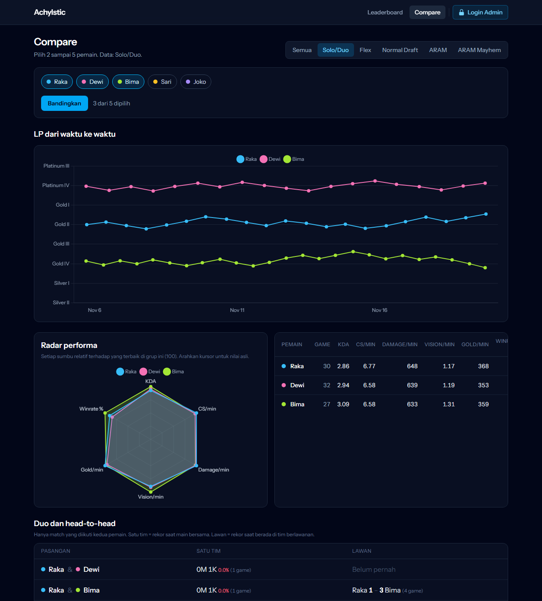
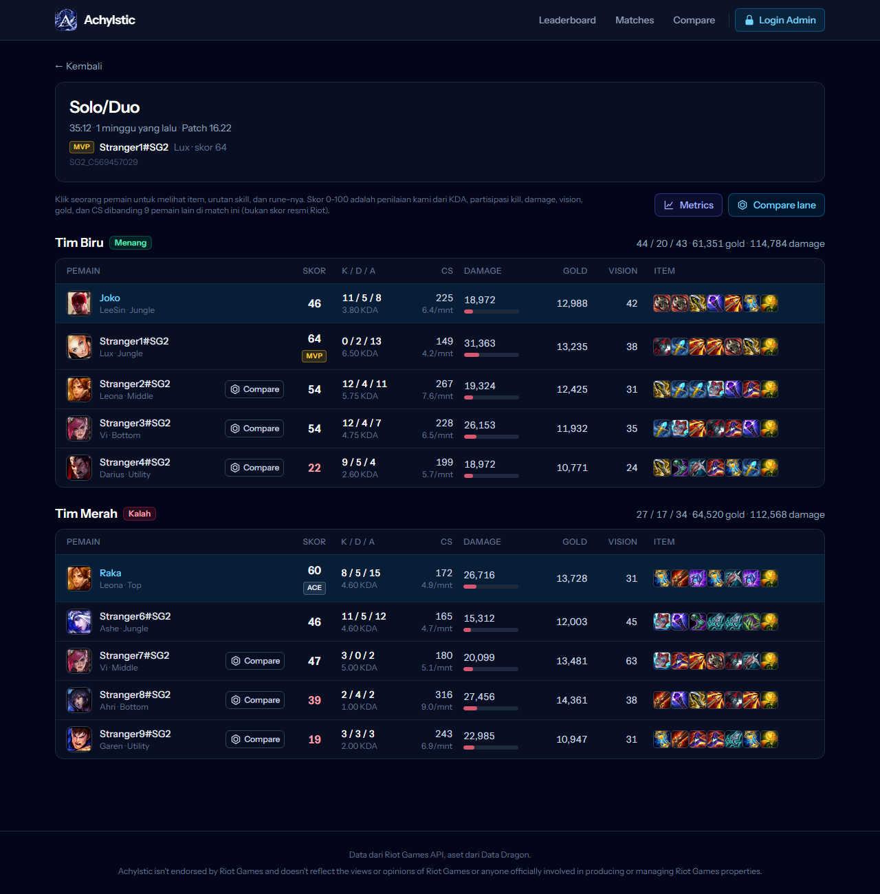
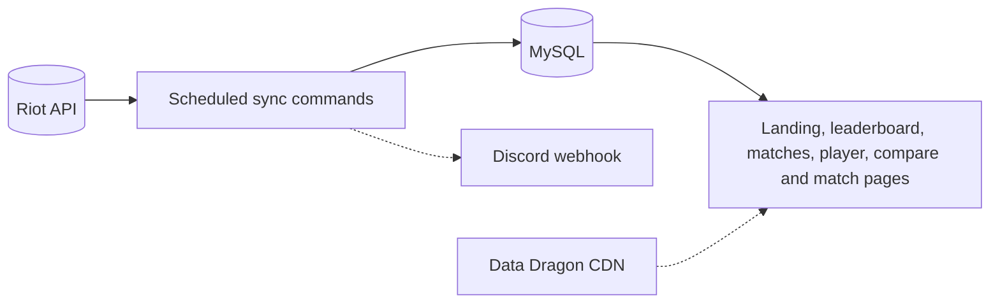

<div align="center">



**Track the League of Legends accounts of your friend group, then see who is really carrying.**

Leaderboard, weekly highlights, LP history, head-to-head records and match breakdowns, built on the official Riot Games API.




<sub>Screenshots use made-up demo players, not real accounts.</sub>

</div>

---

## Why

Riot only tells you your rank **right now**. Achylstic keeps the history for you and your friends: it checks everyone's rank every 15 minutes, stores every match in its own database, and turns that into charts and comparisons that no in-game screen gives you.

Inspired by the guild pages of [dorans.bot](https://dorans.bot) and the match pages of [deeplol.gg](https://www.deeplol.gg).

> The interface text is currently in Indonesian.

## Features

### Landing page

The home page introduces the app with its logo, the number of tracked players and matches, what you can see here and how it works, and leads to the leaderboard.

### Leaderboard



Everyone in the group ranked by tier, division and LP. Switch between Solo/Duo and Flex, see winrate, games played, the LP gained over the last 7 days and the **Climber of the Week**. Below the table:

- **Best this week**: the standout games of the last 7 days (best-rated win, most assists in a win, most takedowns in a game, lowest-rated loss). A dropdown limits them to one game mode.
- **This week**: awards for players with at least 3 games (The Carry, One-Trick Pony, Jack of All Trades, Vision Enthusiast).
- **Role Coverage**: who mains and who fills each lane, and which lanes the group is missing.

### Matches



Every stored game of the group, newest first and grouped by day, with each player's champion, K/D/A, KDA, CS/min, kill participation and score. Filter by player and by game mode; the side panels show the **most played champions** and **role split** (with winrates) of that selection.

### Player page


- **LP over time** from stored rank snapshots (a line chart of the climb)
- Averages: KDA, CS/min, damage/min, gold/min and vision/min
- **Performance trend**: the last 10 games against the up to 40 games before them for KDA, CS/min, damage/min, vision/min and winrate, with the change in percent
- **Lanes**: games, share, KDA and winrate per lane
- Top champions, recent matches (with a link to every match of the player), and the record with every friend, both on the same team and against each other
- Filter by game mode: All, Solo/Duo, Flex, Normal Draft, ARAM and ARAM Mayhem

### Best duos


Pairs of friends ranked by their winrate on the same team (at least 3 games together), with their record against each other, the **most played duo** and the **biggest rivalry**. Filter by game mode.

### Compare 2 to 5 players



LP chart of everyone in one graph, a radar chart (KDA, CS/min, damage/min, vision/min, gold/min, winrate), a metrics table, bar charts per metric, and a duo / head-to-head table. Each player keeps the same colour on every chart.

### Match page



- Scoreboard of all 10 players with an own **0 to 100 score**, an **MVP** badge for the best player of the winning team and an **ACE** for the best of the losing team
- Click a player to open their **build**: item purchases by minute, skill order and runes
- **Compare lane**: put each role against the same role of the other team in a radar chart and a metric table
- **Metrics**: a pop-up line chart of **gold, damage, exp and CS** of all ten players after every minute; click a champion icon to show or hide a line


> The score is Achylstic's own formula (KDA, kill participation, damage, vision, gold and CS against the other nine players), not an official Riot rating.

### Admin area

A **Login Admin** button leads to a small admin area where the admin can add a friend by Riot ID (`Name#TAG`), change nicknames and hide or show players on the leaderboard. A **Sinkron sekarang** button fetches ranks, matches and timelines in the background without waiting for the schedule (it also starts by itself after adding a friend). Admin accounts are created only from the command line, there is no sign-up page.

### Discord notifications

Optional. A webhook posts a message when a match of the group ends, when someone is promoted or demoted, and on win streaks (3, 5, 7, 10, 15 and 20 games).

The match message has one block per tracked player: champion, lane and the champion of the lane opponent, K/D/A, KDA, CS/min, kill participation, damage, and the 0 to 100 score with an MVP or ACE badge. When a rate moved by 15% or more over the last 10 games, a line says so (for example "CS/min up 226% to 6.0 over the last 10 games, was 1.8"). The title shows the result and game mode, the footer the duration and patch.

Two more messages:

- **Weekly summary**, every Monday at 09:00: the top climber, the standout games and the awards of the past 7 days. Send it by hand with `php artisan discord:weekly`.
- **API key warning**: when Riot rejects the key, Discord hears about it once (not every 15 minutes) and the admin page shows a red banner until the key works again.

### Made for phones too

Dark theme and a responsive layout that works on a small screen. Links to the site show a card with the logo when shared in Discord, WhatsApp and the like (when the site is reachable from the internet). After an update, run `php artisan migrate` to add the new columns.

<p align="center">
  
</p>

## How it works



- **Pages only read from the database.** Every call to Riot happens in background commands run by the scheduler. The one exception is the admin adding a friend, which resolves their Riot ID on the spot.
- **One gateway to Riot.** All requests go through `App\Services\Riot\RiotClient`, which stays inside the key's rate limits (20 per second and 100 per 2 minutes), waits on `429` using `Retry-After`, retries `5xx` responses and logs errors without the API key.
- **Matches never change**, so a match that is already stored is never fetched again.
- **Rank history is built by Achylstic.** A snapshot is stored only when something changed since the last one (LP, wins, losses, tier or division).
- Champion, item and rune images come from [Data Dragon](https://developer.riotgames.com/docs/lol#data-dragon), which needs no API key.

## Tech stack

| Layer | What |
|---|---|
| Backend | Laravel 13, PHP 8.3+ |
| Database | MySQL (tests run on in-memory SQLite) |
| Frontend | Blade, Tailwind CSS 4 (Vite), Alpine.js |
| Charts | Chart.js, with all data prepared in the backend |
| Jobs | Laravel Scheduler and plain Artisan commands |
| Tests | PHPUnit, with `Http::fake()` so Riot is never called for real |

## Getting started

You need PHP 8.3+, Composer, Node.js 20.19+, MySQL 8 and a free [Riot developer API key](https://developer.riotgames.com).

```bash
git clone https://github.com/NoctLeaflet/Achylstic-LoL-Web-Analytics.git
cd Achylstic-LoL-Web-Analytics

composer install
cp .env.example .env        # Windows: copy .env.example .env
php artisan key:generate
```

Open `.env` and fill in your database (`DB_*`) and your Riot key (`RIOT_API_KEY`). Set `APP_NAME=Achylstic` too if you want that name in the header. Create the empty database first, then:

```bash
php artisan migrate
npm install
npm run build
```

Add yourself and your friends, fetch their data and start the site:

```bash
php artisan players:add "Game Name" TAG --name=Nickname
php artisan riot:sync-ranks
php artisan riot:sync-matches
php artisan serve
```

Keep the scheduler running so ranks and matches stay up to date by themselves:

```bash
php artisan schedule:work
```

To use the admin area, create an admin. The password is asked with hidden input and stored only as a hash:

```bash
php artisan admin:set-password your-username
```

### Try it with fake data

No Riot key yet? Seed a separate database with made-up players, ranks and matches. The seeder refuses to run on any database whose name does not end in `_demo`, so it cannot touch real data.

```bash
# create a database named achylstic_demo, point DB_DATABASE at it in .env, then:
php artisan migrate:fresh --seed --seeder=DemoDataSeeder
php artisan serve
```

### Share it with friends

You can show your local site through a tunnel such as VS Code port forwarding (set the port visibility to **Public**) or ngrok.

- Run `npm run build` first and do not leave `npm run dev` running. The Vite dev server is only reachable from your own computer, so a friend's browser would load the page without any styling.
- The app trusts the `X-Forwarded-Proto`, `X-Forwarded-Host` and `X-Forwarded-Port` headers, so links and assets use the tunnel's `https` address instead of being blocked as mixed content.

## Configuration

| `.env` | Purpose |
|---|---|
| `RIOT_API_KEY` | Your Riot key. Development keys expire every 24 hours, and an expired key shows a clear "API key kedaluwarsa/invalid" message instead of failing silently. |
| `RIOT_PLATFORM` | Default server for summoner and league data, for example `sg2`, `ph2`, `th2`, `tw2` or `vn2`. |
| `RIOT_REGION` | Routing for match data, for example `sea`. |
| `RIOT_ACCOUNT_REGION` | Routing for Riot ID lookups, for example `asia`. |
| `DISCORD_WEBHOOK_URL` | Optional Discord webhook. Leave it empty to turn notifications off. |

Which game modes are fetched is set in `config/services.php` (`riot.tracked_queues`). The default is Solo/Duo, Flex, Normal Draft, ARAM and ARAM Mayhem. Add `480` for Swiftplay, at the cost of one extra request per player per sync.

## Commands

| Command | What it does | Scheduled |
|---|---|---|
| `players:add {gameName} {tagLine} {--name=} {--platform=}` | Adds a player by Riot ID | |
| `riot:sync-ranks` | Stores a rank snapshot for every active player when something changed | every 15 min |
| `riot:sync-matches {--count=20}` | Fetches new matches, and details only for matches not stored yet | every 30 min |
| `riot:sync-timelines {--limit=30}` | Fetches item purchases, skill order and the per-minute gold, damage, exp and CS for stored matches (use `--limit=200` to catch up after an update) | at :15 and :45 |
| `riot:sync-all` | Runs the three syncs above one after another (what the admin "Sinkron sekarang" button starts) | |
| `discord:test` | Sends a test message to the configured webhook | |
| `discord:weekly` | Sends the weekly summary to the webhook | Mondays 09:00 |
| `admin:set-password {username}` | Creates an admin or changes their password | |

## Discord webhook

1. In your Discord server open **Server Settings, Integrations, Webhooks** and create a webhook.
2. Put its URL in `DISCORD_WEBHOOK_URL` in `.env`.
3. Check it with `php artisan discord:test`.

A match is announced once, only if it ended within the last 3 hours, so adding a new player never floods the channel with their history. Messages cannot ping anyone.

## Security

- The Riot key lives only in `.env` and is read through `config('services.riot.key')`. It is never sent to the browser, written to logs or returned in JSON.
- The Discord webhook URL contains a secret token. Treat it like a password.
- `.env` is git-ignored, and `.env.example` ships with empty values.
- The admin login is throttled, sessions are regenerated on login, and passwords are stored as bcrypt hashes. Use a strong password and never share it in public.

## Tests

```bash
php artisan test
vendor/bin/pint --test      # code style
```

The suite has 420+ tests and runs on in-memory SQLite (the `pdo_sqlite` PHP extension must be enabled). The Riot API is always faked, so tests never use your real key.

## Project layout

```text
app/
├── Console/Commands/        players:add, riot:sync-*, discord:test, admin:set-password
├── Http/Controllers/        thin controllers (+ Admin/ for the admin area)
├── Services/
│   ├── Riot/                RiotClient, account, league, match and Data Dragon services
│   ├── Stats/               leaderboard, KDA and per-minute stats, duo / head-to-head, match score,
│   │                        weekly highlights, role coverage, match metrics, performance trend
│   ├── Sync/                background runner and status of the admin "sync now" button
│   ├── Players/             PlayerRegistrar (shared by the command and the admin page)
│   └── Discord/             webhook client and message builders
├── Events/ + Listeners/     match recorded, rank changed
└── Models/                  Player, RankSnapshot, GameMatch, MatchParticipant, Admin
resources/views/             Blade pages and components
routes/                      web routes and the sync schedule
```

## Not planned

Champion tier lists, global builds and rune stats, betting, public user accounts, and support for more than one group.

## Legal

Achylstic isn't endorsed by Riot Games and doesn't reflect the views or opinions of Riot Games or anyone officially involved in producing or managing Riot Games properties. Riot Games, and all associated properties are trademarks or registered trademarks of Riot Games, Inc.
