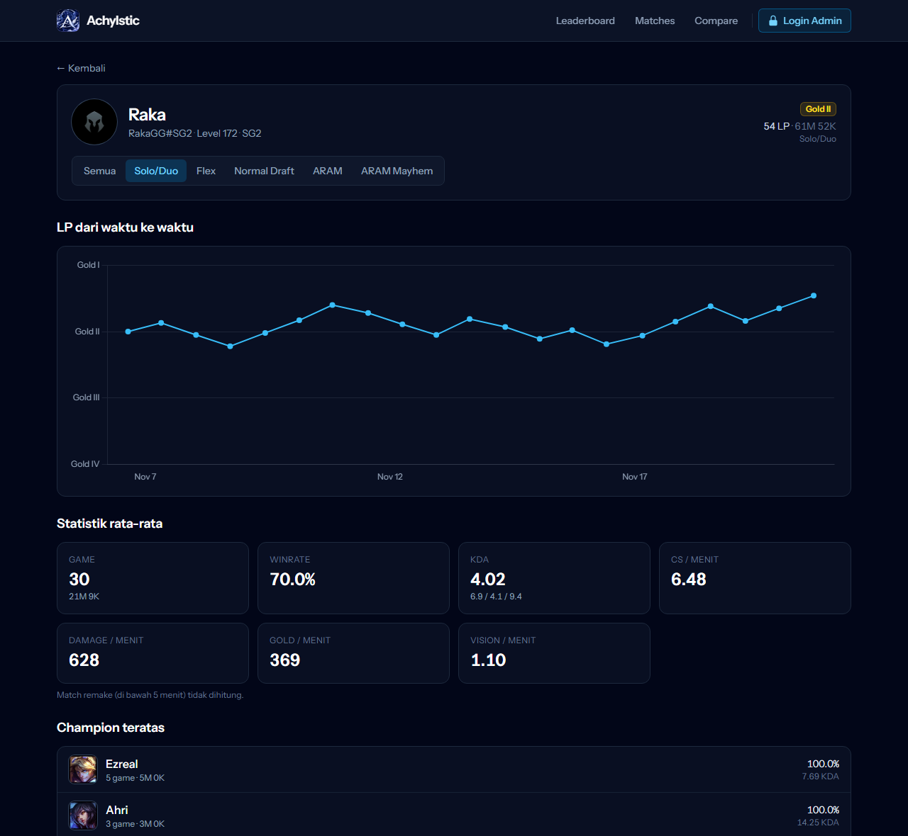
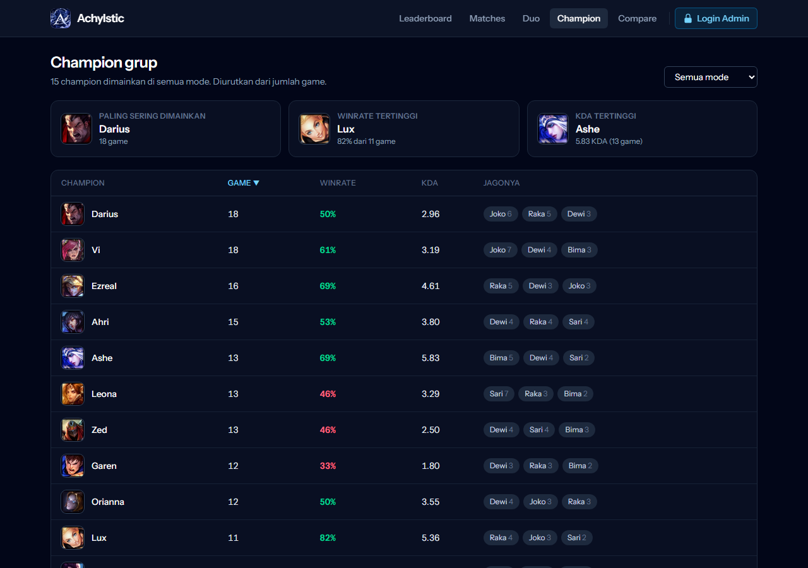
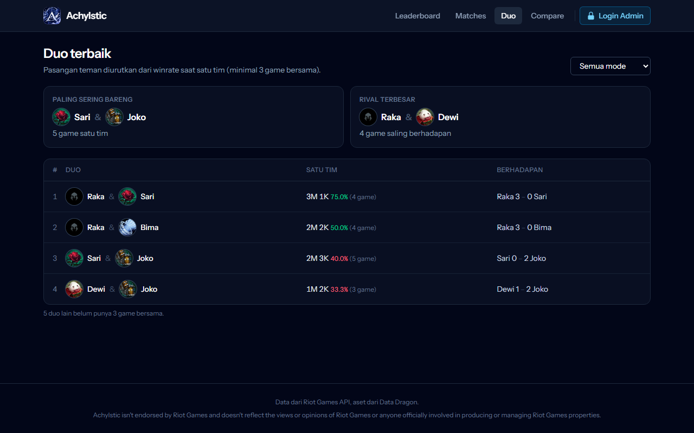
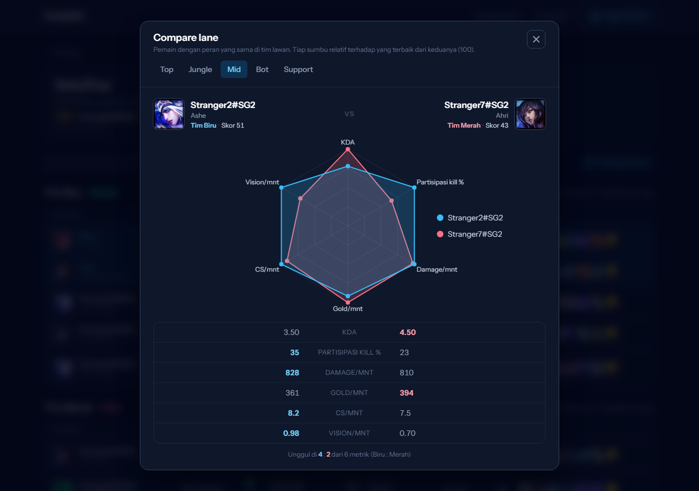
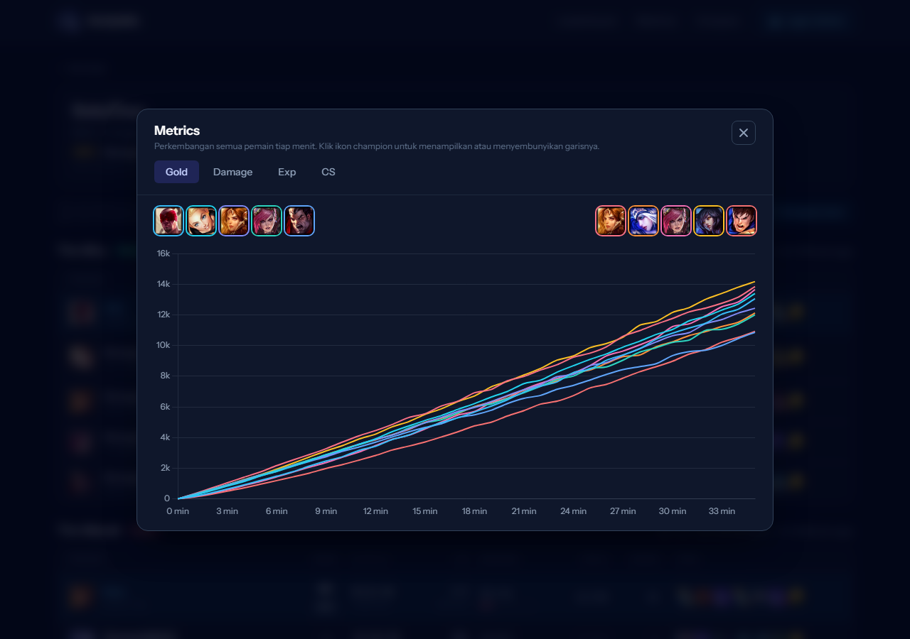
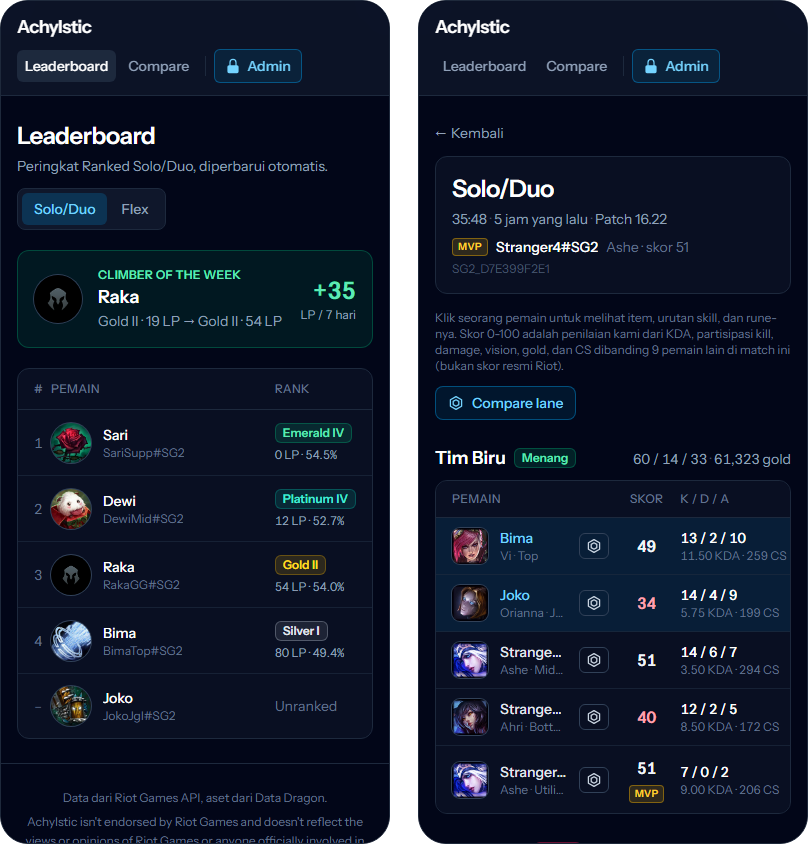
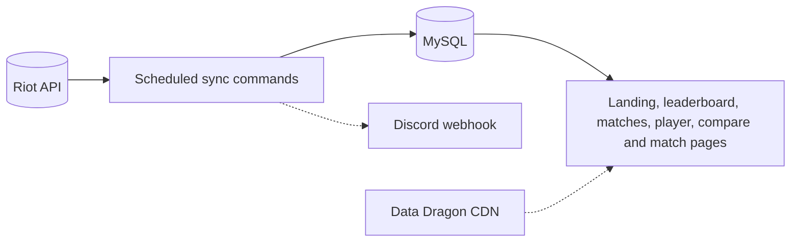

<div align="center">


**Track the League of Legends accounts of your friend group, then see who is really carrying.**

Leaderboard, weekly highlights, LP history, head-to-head records and match breakdowns, built on the official Riot Games API.


<sub>Screenshots use made-up demo players, not real accounts.</sub>

</div>

---

## Why

Riot only tells you your rank **right now**. Achylstic keeps the history for you and your friends: it checks everyone's rank every 15 minutes, stores every match in its own database, and turns that into charts and comparisons that no in-game screen gives you.

Inspired by the guild pages of [dorans.bot](https://dorans.bot) and the match pages of [deeplol.gg](https://www.deeplol.gg).

> The interface text is currently in Indonesian.

## Features

### Landing page

The home page introduces the app with its logo, the number of tracked players and matches, what you can see here and how it works, and leads to the leaderboard.

### Leaderboard


Everyone in the group ranked by tier, division and LP. Switch between Solo/Duo and Flex, see winrate and games played. A **period switch** (Hari, Minggu, Bulan, All Time) sets the LP gain, the trend line and the **Climber** (shown with the champions, lane and number of games they played in that period). Each row also has a **Form** of the last 10 ranked results as green/red dots with the current streak (W3, L2), a small **LP trend** line and a **Target** progress bar towards the rank goal. Below the table:

- **Best this week**: the standout games of the last 7 days (best-rated win, most assists in a win, most takedowns in a game, lowest-rated loss). A dropdown limits them to one game mode.
- **This week**: awards for players with at least 3 games (The Carry, One-Trick Pony, Jack of All Trades, Vision Enthusiast).
- **Role Coverage**: who mains and who fills each lane, and which lanes the group is missing.
- **Top champion grup**, **Duo terbaik** (best winrate together, at least 3 games) and **Winrate per role**.
- **When the Server Plays**: a weekday-by-hour heatmap (Indonesian time, WIB) coloured from bad days (red) to good days (green), and a per-hour bar chart of wins and losses.

### Matches


Every stored game of the group, newest first and grouped by day, with each player's champion, summoner spells, keystone and secondary rune, final items, K/D/A, KDA, CS/min, kill participation, the line-up of both teams, the score and the **place by score** in that match (#1 to #10, also on the player page). The side panel adds a **Streak sekarang** list (win and lose streaks of 2 or more games) and colours the role split green and red by wins and losses. Filter by player and by game mode; the side panels show the **most played champions** and **role split** (with winrates) of that selection. Friends who played the same match are shown together in one framed group ("5 teman main bareng", blue when they won, red when they lost, violet when they faced each other), with a wider gap to the next match. Results are written as Win / Lose.

### Live

`/live` shows who of the group is in a game right now (queue, running timer, both teams with the friends highlighted, and bans), plus a status for every player: in a game, just finished, or not playing. Riot has no "online" status, so that is all that can be known. The page refreshes itself every 30 seconds.

### Player page



- **LP over time** from stored rank snapshots (a line chart of the climb)
- Averages: KDA, CS/min, damage/min, gold/min and vision/min
- **Performance trend**: the last 10 games against the up to 40 games before them for KDA, CS/min, damage/min, vision/min and winrate, with the change in percent
- **Header menu**: buttons for the season recap, champion mastery and achievements, each opening as a pop-up; top champions and lanes sit side by side
- **Lanes**: games, share, KDA and winrate per lane
- **Rank goal**: the admin can set a Solo/Duo target (for example Gold I); the page shows the progress, the LP to go and an estimate of the days left from the pace of the last 14 days
- **Achievements**: 13 badges computed from stored data (100 and 500 games, 10 wins in a row, a deathless win, 20 kills, 25 assists, 100 vision score, 50 games on one champion, 20 different champions, and reaching Gold, Platinum, Emerald and Diamond)
- **Champion mastery**: level and points of the top 10 champions, refreshed daily from Riot
- **Live status**: a "Sedang main" badge (also on the leaderboard) while the player is in a game
- **Season recap**: a shareable card (`/players/{id}/recap`) for the season, the last 90 or the last 30 days: games, winrate, hours played, KDA, MVP and ACE count, longest win streak, favourite champions and lane, Solo/Duo rank change, the best game and the achievements earned. Set `SEASON_START` in `.env` when a new season begins; take a screenshot of the card to share it as an image
- Top champions, recent matches (with a link to every match of the player), and the record with every friend, both on the same team and against each other
- Filter by game mode: All, Solo/Duo, Flex, Normal Draft and ARAM

### Champions



What the group plays: games, winrate and KDA per champion across all friends, who plays each one most, and highlights for the most played champion, best winrate and best KDA (at least 5 games). Sort by games, winrate or KDA and filter by game mode.

### Member builds

What the friends actually play on a champion, from their own games (never from strangers in the same matches): the most used **rune pages** (keystone, picks, secondary tree and shards) with games and winrate, the most bought **final items** with the winrate of the games that had them, the most used **summoner spell pairs** with their winrate, the **ability order** as a level 1 to 18 table with the ability icons (taken from the game that follows the common pattern most closely), and **Top Players** on the champion, sorted by winrate and then by games. Pick a champion and filter by member and game mode; a member who never played it gets a friendly "never played" page with links to widen the selection. The sample is small by nature, so the page says so and warns when a champion has fewer than 5 games. This is not a global tier list: Riot offers no global statistics, and collecting them would need tens of thousands of matches per patch.

### Best duos



Pairs of friends ranked by their winrate on the same team (at least 3 games together), with their record against each other, the **most played duo** and the **biggest rivalry**. Filter by game mode.

### Compare 2 to 5 players


LP chart of everyone in one graph, a radar chart (KDA, CS/min, damage/min, vision/min, gold/min, winrate), a metrics table, bar charts per metric, and a duo / head-to-head table. Each player keeps the same colour on every chart.

### Match page


- Scoreboard of all 10 players with an own **score (normally 0 to 100, and more than 100 for an outstanding game)**, an **MVP** badge for the best player of the winning team and an **ACE** for the best of the losing team. MVP and ACE rows get a colour wash, a glow and a slow shimmer (it stops for people who prefer reduced motion), also in the match lists and on the player page
- Click a player to open their **build**: item purchases by minute, skill order and runes
- **Compare lane**: put each role against the same role of the other team in a radar chart and a metric table
- **Metrics**: a pop-up line chart of **gold, damage, exp and CS** of all ten players after every minute; click a champion icon to show or hide a line
- **Lanes**: a pop-up with the five lane matchups of the game side by side
- **Performance**: a pop-up with a gold-difference chart and per-player performance of the game





> The score is Achylstic's own formula, not an official Riot rating. It compares the player with the other nine on KDA, kill participation, damage, vision, gold and CS (up to 94 points), adds 6 for a win, and gives up to 30 bonus points for an absolutely outstanding game (high KDA, kill participation and damage share, or a deathless win), so the best possible score is 130.

### Admin area

A **Login Admin** button leads to a small admin area where the admin can add a friend by Riot ID (`Name#TAG`), change nicknames and hide or show players on the leaderboard. A **Sinkron sekarang** button fetches ranks, matches and timelines in the background without waiting for the schedule (it also starts by itself after adding a friend). Under **Lainnya** on each player the admin can also change the server, refresh the Riot ID after a rename, or delete the player for good (rank history and achievements go with them; the matches stay). Admin accounts are created only from the command line, there is no sign-up page.

### Discord notifications

Optional. A webhook posts a message when a match of the group ends, when someone is promoted or demoted, and on win streaks (3, 5, 7, 10, 15 and 20 games).

The match message has one block per tracked player: champion, lane and the champion of the lane opponent, K/D/A, KDA, CS/min, kill participation, damage, and the score (normally 0 to 100, and more than 100 for an outstanding game) with an MVP or ACE badge. When a rate moved by 15% or more over the last 10 games, a line says so (for example "CS/min up 226% to 6.0 over the last 10 games, was 1.8"). The title shows the result and game mode, the footer the duration and patch.

More messages:

- **New game**: "🎮 Sedang bermain" when friends start a game (one message per game, only for games that just started).
- **Achievements**: "🏅 Pencapaian baru!" when a player earns a badge (only recent ones, so the history of a new player stays quiet).

- **Weekly summary**, every Monday at 09:00: the top climber, the standout games and the awards of the past 7 days. Send it by hand with `php artisan discord:weekly`.
- **API key warning**: when Riot rejects the key, Discord hears about it once (not every 15 minutes) and the admin page shows a red banner until the key works again.

### Made for phones too

Dark theme and a responsive layout that works on a small screen. Links to the site show a card with the logo when shared in Discord, WhatsApp and the like (when the site is reachable from the internet). After an update, run `php artisan migrate` to add the new columns.

<p align="center">
  
</p>

## How it works



- **Pages only read from the database.** Every call to Riot happens in background commands run by the scheduler. The one exception is the admin adding a friend, which resolves their Riot ID on the spot.
- **One gateway to Riot.** All requests go through `App\Services\Riot\RiotClient`, which stays inside the key's rate limits (20 per second and 100 per 2 minutes), waits on `429` using `Retry-After`, retries `5xx` responses and logs errors without the API key.
- **Matches never change**, so a match that is already stored is never fetched again.
- **Rank history is built by Achylstic.** A snapshot is stored only when something changed since the last one (LP, wins, losses, tier or division).
- Champion, item and rune images come from [Data Dragon](https://developer.riotgames.com/docs/lol#data-dragon), which needs no API key.

## Tech stack

| Layer | What |
|---|---|
| Backend | Laravel 13, PHP 8.3+ |
| Database | MySQL (tests run on in-memory SQLite) |
| Frontend | Blade, Tailwind CSS 4 (Vite), Alpine.js |
| Charts | Chart.js, with all data prepared in the backend |
| Jobs | Laravel Scheduler and plain Artisan commands |
| Tests | PHPUnit, with `Http::fake()` so Riot is never called for real |

## Getting started

You need PHP 8.3+, Composer, Node.js 20.19+, MySQL 8 and a free [Riot developer API key](https://developer.riotgames.com).

```bash
git clone https://github.com/NoctLeaflet/Achylstic-LoL-Web-Analytics.git
cd Achylstic-LoL-Web-Analytics

composer install
cp .env.example .env        # Windows: copy .env.example .env
php artisan key:generate
```

Open `.env` and fill in your database (`DB_*`) and your Riot key (`RIOT_API_KEY`). Set `APP_NAME=Achylstic` too if you want that name in the header. Create the empty database first, then:

```bash
php artisan migrate
npm install
npm run build
```

Add yourself and your friends, fetch their data and start the site:

```bash
php artisan players:add "Game Name" TAG --name=Nickname
php artisan riot:sync-ranks
php artisan riot:sync-matches
php artisan serve
```

Keep the scheduler running so ranks and matches stay up to date by themselves (a finished game shows up, and reaches Discord, within about 3 minutes):

```bash
php artisan schedule:work
```

On Windows, double-click `start-achylstic.bat`: it opens the website and the scheduler in two windows (keep them open, or put a shortcut to it in the Startup folder). The admin page warns in amber when the scheduler is not running.

To use the admin area, create an admin. The password is asked with hidden input and stored only as a hash:

```bash
php artisan admin:set-password your-username
```

### Try it with fake data

No Riot key yet? Seed a separate database with made-up players, ranks and matches. The seeder refuses to run on any database whose name does not end in `_demo`, so it cannot touch real data.

```bash
# create a database named achylstic_demo, point DB_DATABASE at it in .env, then:
php artisan migrate:fresh --seed --seeder=DemoDataSeeder
php artisan serve
```

### Run it on a server

For a site that stays online 24/7, follow [docs/DEPLOY.md](docs/DEPLOY.md) (Ubuntu VPS with Nginx, PHP 8.3-FPM and MySQL, in Indonesian). The `deploy/` folder has an Nginx config, a cron line for the scheduler and an update script, and `.env.production.example` is the starting point for the server's `.env`.

### Share it with friends

You can show your local site through a tunnel such as VS Code port forwarding (set the port visibility to **Public**) or ngrok.

- Run `npm run build` first and do not leave `npm run dev` running. The Vite dev server is only reachable from your own computer, so a friend's browser would load the page without any styling.
- The app trusts the `X-Forwarded-Proto`, `X-Forwarded-Host` and `X-Forwarded-Port` headers, so links and assets use the tunnel's `https` address instead of being blocked as mixed content.

## Configuration

| `.env` | Purpose |
|---|---|
| `SEASON_START` | First day of the current ranked season (`YYYY-MM-DD`) for the recap page. Empty means 1 January of this year. |
| `RIOT_API_KEY` | Your Riot key. Development keys expire every 24 hours, and an expired key shows a clear "API key kedaluwarsa/invalid" message instead of failing silently. |
| `RIOT_PLATFORM` | Default server for summoner and league data, for example `sg2`, `ph2`, `th2`, `tw2` or `vn2`. |
| `RIOT_REGION` | Routing for match data, for example `sea`. |
| `RIOT_ACCOUNT_REGION` | Routing for Riot ID lookups, for example `asia`. |
| `DISCORD_WEBHOOK_URL` | Optional Discord webhook. Leave it empty to turn notifications off. |

Which game modes are fetched is set in `config/services.php` (`riot.tracked_queues`). The default is Solo/Duo, Flex, Normal Draft and ARAM. Add `480` for Swiftplay, at the cost of one extra request per player per sync. ARAM Mayhem (`2400`) is left out because Riot returned no Mayhem games for any player when it was checked; add it to the list if Riot starts returning them.

## Commands

| Command | What it does | Scheduled |
|---|---|---|
| `players:add {gameName} {tagLine} {--name=} {--platform=}` | Adds a player by Riot ID | |
| `riot:sync-ranks` | Stores a rank snapshot for every active player when something changed | every 15 min |
| `riot:sync-matches {--count=20} {--quick}` | Fetches new matches, and details only for matches not stored yet. `--quick` first asks for the 5 newest ids (one request per player) and only does the full pass when something is new | full every 30 min, quick every 3 min |
| `riot:sync-timelines {--limit=30}` | Fetches item purchases, skill order and the per-minute gold, damage, exp and CS for stored matches (use `--limit=200` to catch up after an update) | at :15 and :45 |
| `players:relink {--dry-run}` | Looks up every player's PUUID again from their Riot ID. Needed after switching to a Riot API key from another application, because PUUIDs are tied to the key (symptom: HTTP 400 on every player) | |
| `riot:sync-live` | Checks which active players are in a game right now and announces new games in Discord | every 2 min |
| `riot:sync-mastery` | Fetches the top 10 champion masteries of every active player | daily 04:00 |
| `riot:sync-all` | Runs ranks, matches, timelines and mastery one after another (what the admin "Sinkron sekarang" button starts); a mastery failure does not fail the rest | |
| `db:backup` | Dumps the database to a compressed file in `storage/app/backups` and keeps the newest 14 | nightly 03:30 |
| `discord:test` | Sends a test message to the configured webhook | |
| `discord:weekly` | Sends the weekly summary to the webhook | Mondays 09:00 |
| `admin:set-password {username}` | Creates an admin or changes their password | |

## Discord webhook

1. In your Discord server open **Server Settings, Integrations, Webhooks** and create a webhook.
2. Put its URL in `DISCORD_WEBHOOK_URL` in `.env`.
3. Check it with `php artisan discord:test`.

A match is announced once, only if it ended within the last 3 hours, so adding a new player never floods the channel with their history. Messages cannot ping anyone.

## Security

- The Riot key lives only in `.env` and is read through `config('services.riot.key')`. It is never sent to the browser, written to logs or returned in JSON.
- The Discord webhook URL contains a secret token. Treat it like a password.
- `.env` is git-ignored, and `.env.example` ships with empty values.
- The admin login is throttled, sessions are regenerated on login, and passwords are stored as bcrypt hashes. Use a strong password and never share it in public.

## Tests

```bash
php artisan test
vendor/bin/pint --test      # code style
```

The suite has 470+ tests and runs on in-memory SQLite (the `pdo_sqlite` PHP extension must be enabled). The Riot API is always faked, so tests never use your real key.

## Project layout

```text
app/
├── Console/Commands/        players:add, riot:sync-*, discord:test, admin:set-password
├── Http/Controllers/        thin controllers (+ Admin/ for the admin area)
├── Services/
│   ├── Riot/                RiotClient, account, league, match and Data Dragon services
│   ├── Stats/               leaderboard, KDA and per-minute stats, duo / head-to-head, match score,
│   │                        weekly highlights, role coverage, match metrics, performance trend
│   ├── Achievements/        badge catalogue and the tracker that finds and announces new ones
│   ├── Sync/                background runner and status of the admin "sync now" button
│   ├── Players/             PlayerRegistrar (shared by the command and the admin page)
│   └── Discord/             webhook client and message builders
├── Events/ + Listeners/     match recorded, rank changed
└── Models/                  Player, RankSnapshot, GameMatch, MatchParticipant, Admin
resources/views/             Blade pages and components
routes/                      web routes and the sync schedule
```

## Not planned

Champion tier lists, global builds and rune stats, betting, public user accounts, and support for more than one group.

## Legal

Achylstic isn't endorsed by Riot Games and doesn't reflect the views or opinions of Riot Games or anyone officially involved in producing or managing Riot Games properties. Riot Games, and all associated properties are trademarks or registered trademarks of Riot Games, Inc.
